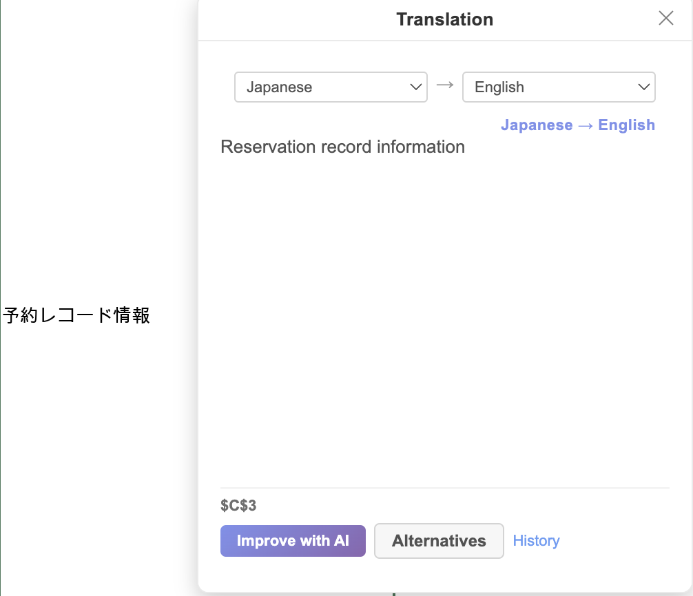
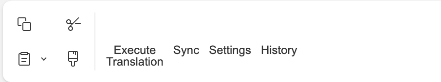
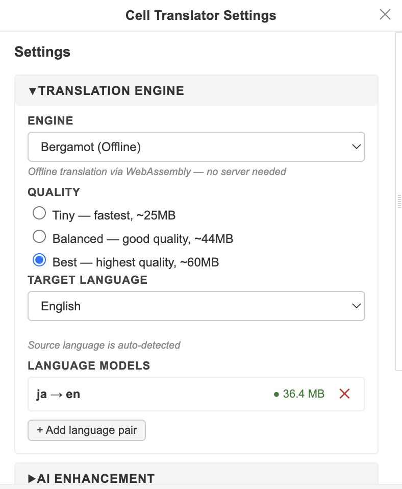
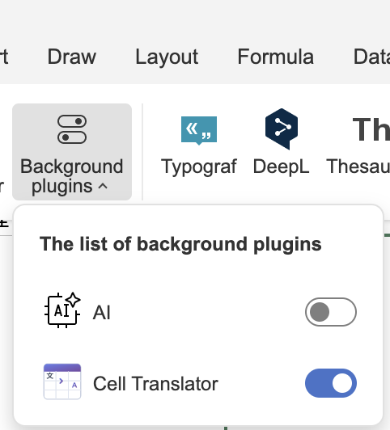
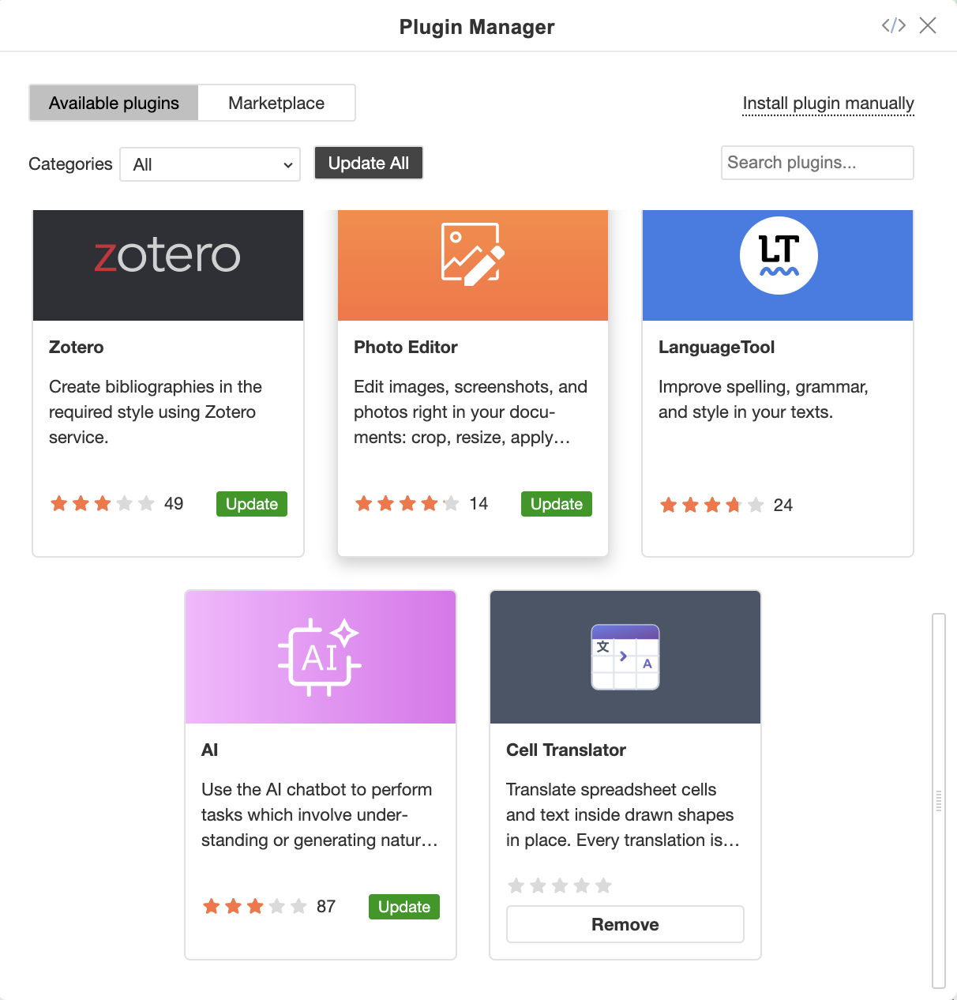

<p align="center">
  
</p>

<h1 align="center">Cell Translator</h1>

<p align="center">
  Translate spreadsheet cells and shape text in place — and keep the record inside the file.
</p>

<p align="center">
  <a href="LICENSE"></a>
  
  
</p>

---

An [ONLYOFFICE](https://www.onlyoffice.com/) **spreadsheet** plugin that translates cell
content and text inside drawn shapes, then records every translation in a hidden
sheet inside the workbook itself.

That last part is the point. Translation memory lives in the file, not on your
machine, so it travels with the workbook when it is copied, emailed or renamed.
Repeated text is translated once and reused; any translated cell can be reverted
to its original.

<p align="center">
  
</p>


## Features

- **Three engines** — offline (Bergamot), self-hosted (LibreTranslate), or any
  OpenAI-compatible endpoint.
- **Works offline.** Bergamot runs as WebAssembly in the editor. Language models
  download once and are cached locally.
- **Translation memory in the workbook.** A hidden `_CellTranslator` sheet holds
  the ledger, so identical text is never translated twice.
- **Shapes too.** Text inside autoshapes and callouts is translated per
  paragraph, preserving each paragraph's formatting.
- **Revert anything.** Every translated cell keeps a route back to its original.
- **Refine a single cell** with AI, or pick from alternative translations
  (LibreTranslate only).
- **Automatic language detection**, with a manual override per cell.

## Requirements

- ONLYOFFICE Desktop Editors or Docs **9.4 or newer**
- Node.js 20+ (only to build the plugin)

## Install

There is no marketplace listing yet, so installation is manual. Download
`cell-translator-vX.Y.Z.plugin` from the [latest release](../../releases/latest),
or build it yourself (see [Development](#development)).

Every release also ships a `.sha256` file. Worth checking, since the plugin runs
inside your editor:

```bash
shasum -a 256 -c cell-translator-v1.0.2.plugin.sha256
```

### Desktop Editors

1. Open the **Plugins** tab
2. Click **Plugin Manager**
3. Go to the **My plugins** tab
4. Click **Install plugin manually**
5. Select the `.plugin` file and click **Open**

It becomes available immediately, in open documents and future ones.

If you would rather drop it in as a folder, unzip the `.plugin` (it is a plain
zip) into a directory named `cell-translator` under:

```
Windows   %ProgramFiles%\ONLYOFFICE\DesktopEditors\editors\sdkjs-plugins\
macOS     ~/Library/Application Support/asc.onlyoffice.ONLYOFFICE/data/sdkjs-plugins/
Linux     /opt/onlyoffice/desktopeditors/editors/sdkjs-plugins/
```

### ONLYOFFICE Docs (self-hosted)

Docs takes a plugin **folder**, not a `.plugin` archive, so unzip it first:

```bash
mkdir cell-translator
unzip cell-translator-v1.0.2.plugin -d cell-translator
```

Then move it into the plugins directory:

```bash
# Linux
sudo mv cell-translator /var/www/onlyoffice/documentserver/sdkjs-plugins/

# Windows
move cell-translator %ProgramFiles%\ONLYOFFICE\DocumentServer\sdkjs-plugins\
```

On Linux, restart the services if the plugin does not appear:

```bash
sudo systemctl restart ds-converter ds-docservice ds-example ds-metrics
```

The plugin is then available to every user of that server.

For Docker, copy the folder to the same path inside the container, or mount it
there. ONLYOFFICE publishes no official Docker instructions for this, so treat
the following as a starting point rather than a documented procedure:

```bash
docker cp cell-translator \
  <container>:/var/www/onlyoffice/documentserver/sdkjs-plugins/
```

Cloud (onlyoffice.com) installations cannot take manually installed plugins.

## Usage

| Action | How |
| --- | --- |
| Translate a sheet | Toolbar → Cell Translator → **Execute Translation** |
| Inspect one cell | Right-click a cell → **Show translation panel** |
| Translate a shape | Select the shape with the panel open |
| Change engine or target language | Toolbar → Cell Translator → **Settings** |
| Undo a translation | Translation panel → **Revert** |

By default translations are shown in the panel and the sheet is left untouched.
Switch **Display Mode** to *Replace* in Settings to write translations into the
cells themselves.

## Screenshots

The toolbar, under the **Cell Translator** group:

<p align="center">
  
</p>

Settings — engine, quality, target language and downloaded models:

<p align="center">
  
</p>

The plugin runs in the background, so it appears under **Background plugins**
as well as in the Plugin Manager:

<p align="center">
  
  
</p>


## Engines

| Engine | Runs where | Needs | Notes |
| --- | --- | --- | --- |
| **Bergamot** | Locally, WebAssembly | Nothing | Default. Fully offline once models are cached. |
| **LibreTranslate** | Your own server | A running instance | The only engine that offers alternative translations. |
| **AI** | Any OpenAI-compatible API | Endpoint + model | Also powers *Improve with AI* on a single cell. |

A `compose.yml` is included to run LibreTranslate locally:

```bash
docker compose up -d      # http://localhost:15065
```

## How translations are stored

```
_CellTranslator (hidden sheet)
  A–D   ledger    checksum | source | translation | txn
  E–G   refs      sheet | cellRef -> ledgerRow
  I–J   history   timestamped events
```

The ledger is keyed by a checksum of the source text, so the same phrase
repeated across hundreds of cells is translated once. Refs map each cell — or
each shape paragraph — back to its ledger row, which is what makes revert
possible.

See [docs/ARCHITECTURE.md](docs/ARCHITECTURE.md) for the full design.

## Development

```bash
npm install
npm run build       # bundle into dist/
npm run pack        # build + zip into translator-plugin.plugin
npm run icons       # re-rasterise icons from assets/*.svg
npm run lint        # biome
npm run lint:fix
```

Icons are committed as PNGs because ONLYOFFICE wants a fixed set of sizes, but
they are generated, not hand-drawn. The sources are `assets/icon.svg` (plugin
list), `assets/icon-store.svg` (marketplace card) and `assets/toolbar/*.svg`
(toolbar buttons). Edit those and run `npm run icons`.

Source lives in `src/`, one directory per plugin window, each with a `main.js`
entry that the build bundles into a single IIFE (the ONLYOFFICE plugin sandbox
does not support ES modules).

```
src/
  background/        the controller — owns all state and logic
  panel/             Cell Translator panel
  settings/          Settings panel
  translation-view/  per-cell inspector
  sync/              manual sync to the document
  shared/            engines, ledger, sidecar sheet, logging
```

## Privacy

Bergamot translates entirely on your machine; nothing leaves it. Choosing
LibreTranslate or AI sends cell text to whichever endpoint you configure — pick
one you trust with the contents of your spreadsheets.

Your AI API key is stored in the editor's `localStorage`, unencrypted. Treat it
as you would any other credential kept in a browser profile.

## Contributing

Issues and pull requests are welcome — see [CONTRIBUTING.md](CONTRIBUTING.md).

## Licence

MIT — see [LICENSE](LICENSE).

Bundled third-party components under `vendors/` keep their own licences; see
[NOTICE](NOTICE), which also records an unresolved licensing question about the
vendored Bergamot package.
